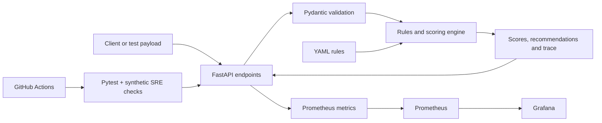

# Cloud Advisory Copilot

**A cloud-agnostic, rules-based workload assessment API built with Python and FastAPI.**

Cloud Advisory Copilot evaluates workload requirements across five architecture domains—**cost, security, reliability, performance, and operations**—and returns structured scores, prioritized recommendations, and explanations. It also demonstrates operational validation through GitHub Actions, synthetic API checks, and Prometheus-compatible metrics.

> **Project scope:** This is an engineering portfolio project and a deterministic advisory engine, not an AI/LLM service or a live scanner of AWS, Azure, or GCP accounts. Assessments are based on supplied workload inputs and versioned YAML rules.

## What this project demonstrates

- **API engineering:** Request validation and structured responses using FastAPI and Pydantic.
- **Configuration-driven decisions:** YAML rules evaluated against workload metadata rather than hard-coded advice in individual routes.
- **Explainability:** Optional assessment traces and an endpoint that describes score changes.
- **Software quality:** Pytest coverage and GitHub Actions CI.
- **Site reliability practices:** Scripted availability, functional-output, and latency checks that can fail a CI job.
- **Observability:** Prometheus metrics endpoints with optional local Prometheus and Grafana services.

## Architecture




### Assessment flow

1. A client submits workload details, such as environment, traffic profile, availability target, and data sensitivity.
2. Pydantic validates and normalizes the input.
3. The rules engine loads the rules from `rules/*.yaml`, evaluates matching conditions, and adjusts baseline scores.
4. The API returns five domain scores (0–100), prioritized recommendations, and optional decision traces.

The engine uses transparent, configurable rules. It does not make changes to cloud resources.

## API endpoints

| Method | Endpoint | Purpose |
|---|---|---|
| `GET` | `/health` | Basic service health response |
| `GET` | `/rules` | List loaded advisory rules |
| `POST` | `/assess` | Evaluate a workload and return scores and recommendations |
| `POST` | `/explain` | Return a plain-language explanation of scoring decisions |
| `POST` | `/report` | Generate a Markdown assessment report returned in JSON |
| `GET` | `/metrics` | Expose Prometheus-compatible application metrics |
| `GET` | `/docs` | Interactive OpenAPI documentation provided by FastAPI |

### Example assessment input

```json
{
  "workload_type": "web_api",
  "environment": "prod",
  "traffic_profile": "medium",
  "availability_target": "high",
  "data_sensitivity": "confidential",
  "budget_priority": "balanced",
  "team_experience": "junior",
  "provider_hints": {"trace": true}
}
```

The `/assess` response contains `normalized_input`, `scores`, `recommendations`, and `meta`. It also includes `trace` when requested through `provider_hints.trace`.

## Run locally

**Prerequisites:** Python 3.11 (used by CI), pip, and PowerShell for the SRE script. Docker is optional for Prometheus and Grafana.

Run from the repository root in PowerShell:

```powershell
python -m venv .venv
.\.venv\Scripts\Activate.ps1
python -m pip install -r requirements.txt
python -m uvicorn app.main:app --host 127.0.0.1 --port 8000
```

With the API running, open another terminal and try:

```powershell
curl.exe http://127.0.0.1:8000/health
curl.exe http://127.0.0.1:8000/rules
curl.exe -X POST http://127.0.0.1:8000/assess `
  -H "Content-Type: application/json" `
  --data-binary "@examples/requests/high_security.json"
```

Interactive API docs are available at `http://127.0.0.1:8000/docs`.

## Testing and CI

### Automated tests

```powershell
python -m pytest -q
```

The repository includes tests for API endpoints, rule loading, score calculations, and score boundaries.

### GitHub Actions

- `.github/workflows/ci.yml` runs the Python tests on pushes and pull requests.
- `.github/workflows/sre-check.yml` launches the FastAPI service and runs the PowerShell validation script on pushes and pull requests to `main` (also supports manual runs).

These workflows provide repeatable quality and operational checks, but do not represent a continuously deployed production service.

### Synthetic SRE validation

With the API running on `127.0.0.1:8000`:

```powershell
.\scripts\daily-sre-check.ps1
```

The script checks that required example inputs exist, verifies `/health`, exercises `/assess` against multiple workloads, checks response fields and rule availability, and enforces configured latency thresholds. It exits nonzero when a check fails.

The thresholds in the script are **500 ms for `/health`** and **1,000 ms for `/assess`** per request. These are demonstration check thresholds, not a measured production SLO.

## Observability

The API exports metrics at `/metrics`, including request-level instrumentation and custom counters/latency histograms for assessment and report calls.

To run the optional monitoring stack:

```powershell
docker compose -f docker-compose.observability.yml up -d
```

- **Prometheus:** `http://localhost:9090`
- **Grafana:** `http://localhost:3000`

The included Prometheus configuration scrapes `host.docker.internal:8000`. For a local Docker Desktop monitoring demo, launch the API with `--host 0.0.0.0 --port 8000` if containers cannot reach the loopback-only listener. Only do this on a trusted development machine/network: the API does not implement authentication. Keep `127.0.0.1` for API-only local testing.

Configure Prometheus as a Grafana data source if you want to explore dashboards; no prebuilt Grafana dashboard is claimed by this repository.

To stop the monitoring stack:

```powershell
docker compose -f docker-compose.observability.yml down
```

## Repository guide

```text
app/
  api/          FastAPI routes and Pydantic request/response models
  core/         Rules, scoring, explanation, and reporting logic
  rules/        YAML loading and rule schemas
  sre/          Separate SLO-evaluation example
rules/          Configurable advisory rule sets
examples/       Example workload inputs and sample outputs
scripts/        PowerShell SRE validation script
tests/          Automated Python tests
observability/  Prometheus scrape configuration
.github/workflows/  CI and SRE-check workflows
docs/           Architecture diagram
```

## Design choices and limitations

- **Cloud-agnostic by design:** Inputs describe workload requirements instead of reading provider inventories. There are no live AWS/Azure/GCP integrations.
- **Deterministic recommendations:** Rule matches and score deltas are inspectable. Results are advisory and depend on rule coverage and input accuracy.
- **Separate health and functional checks:** A passing `/health` response alone does not demonstrate that `/assess` works; the SRE script tests both.
- **Local-first reproducibility:** The application can be reviewed and tested without provisioning cloud infrastructure.
- **Demo rather than production service:** Authentication, authorization, managed hosting, and operational hardening would need further work before deploying for untrusted users.

## Possible next steps

- Expand rule coverage and test cases.
- Add historical assessment comparisons and trends.
- Introduce authentication and authorization before exposing the service publicly.
- Add provider-specific integrations as optional, explicitly scoped modules.
- Provide reproducible Grafana dashboard provisioning and additional SLO reporting.

## Project takeaway

The core lesson is that cloud advice becomes more useful when decisions are **repeatable, explainable, testable, and observable**. This project brings those practices together in a small, reviewable Python service.